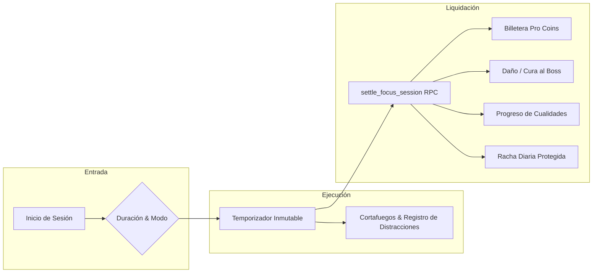
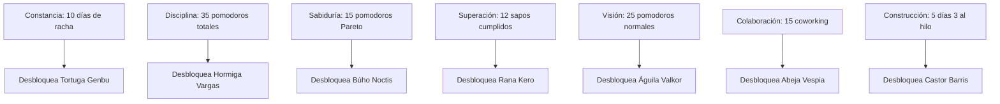
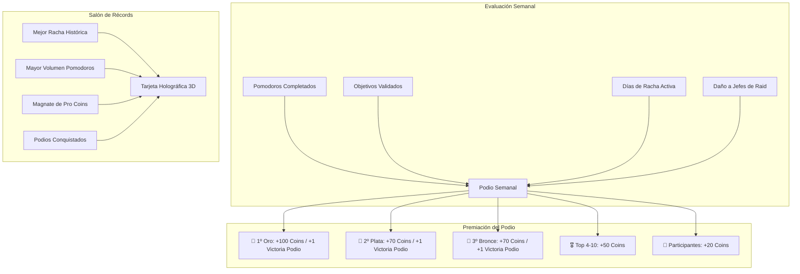
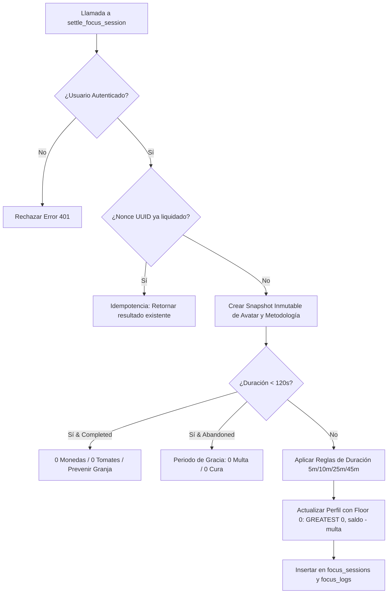

# 🛡️ PROCRASTINA COMO UN PRO (COFU) - DOCUMENTO MAESTRO DE REGLAS DE NEGOCIO Y GAMIFICACIÓN

> **Versión del Documento:** 1.0.0  
> **Ubicación en el Repositorio:** `supabase/REGLAS_DE_NEGOCIO.md`  
> **Archivo de Esquema Relacionado:** `supabase/schema.sql`  
> **Propósito:** Fuente Única de Verdad (*Single Source of Truth - SSOT*) de la lógica de negocio, fórmulas matemáticas, balances de economía virtual (Pro Coins / XP), mecánicas de combate, habilidades pasivas de los 24 Guardianes, progresión de cualidades y blindaje anti-exploits.

---

## 📑 ÍNDICE GENERAL
1. [Filosofía General y Arquitectura de Gamificación](#1-filosofía-general-y-arquitectura-de-gamificación)
2. [Sistema de Temporizador, Inicios Rápidos y Duraciones](#2-sistema-de-temporizador-inicios-rápidos-y-duraciones)
3. [Catálogo Maestro de los 24 Guardianes / Avatares](#3-catálogo-maestro-de-los-24-guardianes--avatares)
4. [Metodologías de Enfoque y Sinergias Tácticas](#4-metodologías-de-enfoque-y-sinergias-tácticas)
5. [Modos de Sesión: Individual vs Coworking Comunitario](#5-modos-de-sesión-individual-vs-coworking-comunitario)
6. [Niveles de Motivación Inicial y Bono de Coraje (Grit Bonus)](#6-niveles-de-motivación-inicial-y-bono-de-coraje-grit-bonus)
7. [Sistema de Combate contra Jefes de Raid y Armería](#7-sistema-de-combate-contra-jefes-de-raid-y-armería)
8. [Sistema de Cualidades de Honor (7 Virtudes del Dojo)](#8-sistema-de-cualidades-de-honor-7-virtudes-del-dojo)
9. [Progresión de Usuario: Niveles, Rangos, Rachas y Medallero](#9-progresión-de-usuario-niveles-rangos-rachas-y-medallero)
10. [Blindaje Anti-Exploits y Reglas de Seguridad Algorítmica](#10-blindaje-anti-exploits-y-reglas-de-seguridad-algorítmica)
11. [Economía Virtual del Juego (Pro Coins & XP)](#11-economía-virtual-del-juego-pro-coins--xp)
12. [Módulos Auxiliares de Productividad](#12-módulos-auxiliares-de-productividad)

---

## 🧠 1. FILOSOFÍA GENERAL Y ARQUITECTURA DE GAMIFICACIÓN

El sistema **Procrastina Como Un Pro (COFU)** transforma la lucha contra la resistencia psicológica, la pereza y las distracciones digitales en un juego de rol táctico (*RPG de Productividad*) impulsado por la neurociencia aplicada:

1. **Reducción de Fricción Cognitiva:** Micro-bloques accesibles para romper la inercia del inicio.
2. **Refuerzo Dopamínico Saludable:** Monedas virtuales (*Pro Coins*), puntos de experiencia (*XP*) y desbloqueo de cosméticos tras completar bloques de enfoque real.
3. **Aversión a la Pérdida Calibrada:** La distracción y el abandono tienen consecuencias visibles (descuento de monedas y curación del Jefe de Raid comunitario).
4. **Body Doubling & Presencia Social Silenciosa:** Coworking comunitario en vivo donde el esfuerzo individual contribuye a la defensa y victoria colectiva.

---

## ⏱️ 2. SISTEMA DE TEMPORIZADOR, INICIOS RÁPIDOS Y DURACIONES

El temporizador permite configurar diferentes bloques de trabajo según el estado anímico y la disponibilidad del usuario.

### 🎯 2.1 Regla Maestra de Inicios Rápidos y Recompensas por Duración

Para erradicar la trampa de "no tengo tiempo" o "tengo mucha pereza", el sistema introduce bloques ultracortos con reglas de compensación económica estrictamente controladas:

| Duración | Nombre del Bloque | Propósito Psicológico | Recompensa de Pro Coins | Daño al Boss de Raid | Tomates de Enfoque |
| :--- | :--- | :--- | :---: | :---: | :---: |
| **5 minutos** | **Micro-bloque / Inicio Rápido** | Romper la parálisis y la resistencia inicial (*Regla de los 5 min*). | **1 Pro Coin fija** *(independiente del avatar)* | $\text{Daño Base} \times \frac{5}{25}$ | 0 Tomates |
| **10 minutos** | **Sprint de Baja Motivación** | Arrancar cuando la energía es baja pero se busca generar inercia. | **2 Pro Coins fijas** *(+ Bono de Coraje si aplica)* | $\text{Daño Base} \times \frac{10}{25}$ | 0 Tomates |
| **25 minutos** | **Pomodoro Estándar** | El bloque clásico de concentración profunda sostenida. | **100% Monedas del Avatar Equipado** (+5 a +60 Coins) | **100% Daño Base del Avatar** | **+1 Tomate** |
| **45 minutos** | **Modo Flow / Hiperfoco** | Inmersión prolongada para tareas complejas y extensas. | **100% Monedas del Avatar Equipado** (+ Bonos pasivos de 45+ min) | **100% Daño Base** (+ bonos pasivos) | **+1 Tomate** |
| **50 - 60 min** | **Maratón / Deep Work** | Sesiones avanzadas para usuarios experimentados. | **100% Monedas Avatar** (+25% si equipa a Valkor) | **100% Daño Base** (+56 daño si equipa a Bjorn) | **+1 Tomate** |

### 🛑 2.2 Reglas de Cancelación y Periodo de Gracia
1. **Periodo de Gracia Incondicional (0 a 120 segundos):**
   - Si el usuario cancela o interrumpe la sesión antes de transcurrir los primeros **2 minutos (120 segundos)**, la sesión se descarta sin cobro de multas ni curación al Boss.
2. **Abandono Posterior (> 120 segundos):**
   - Si el usuario abandona una sesión tras superar los 2 minutos, se registra como `abandoned`.
   - Se aplica la penalización de monedas del avatar equipado (`pause_penalty_coins + 15`).
   - Si está en sala comunitaria, el Boss recupera vida (`boss_heal_points + 20` o +2% de su HP máximo) y el Escudo Comunitario pierde 40 puntos.
   - En usuarios Premium, se descuentan `-50 XP` de honor.

### ☕ 2.3 Sistema de Descansos
* **Descanso Corto (*Short Break*):** 5 minutos (predeterminado tras cada bloque de 25 min).
* **Descanso Largo (*Long Break*):** 15 minutos (se sugiere automáticamente cada 4 pomodoros completados).
* **Pasiva de Descanso (Panda Tao):** Cumplir el descanso sugerido sin saltarlo otorga **+10 puntos al Escudo Comunitario** y **+4 Pro Coins de serenidad**.

### 🎧 2.4 Regla de Sonidos de Fondo, Previews y Escudos Acústicos
El sistema integra la biblioteca completa de **50+ frecuencias de fondo, metrónomos y alarmas** con sus nombres originales y grabaciones en alta fidelidad:

* **🌿 Paisajes Sonoros y Naturaleza (HQ Audio Loops):**
  * *Amazon Forest River, Beach, New Beach, Campfire, Dusk Woods, New Dusk in the Woods, Morning Birds, Rainy Mountains, Waves, Underwater, Natural Wind, Natural Wind Heavy, Normal Wind, Real Wind, Stormy Wind, Calm Village, Experimental Nature, Park by the River, Floating Space, Exotic Calm.*
* **☕ Cafeterías y Entornos Urbanos:**
  * *Coffee Shop, New Coffee Shop, College Campus Cafe, Rome Restaurant, Berlin City Center, Busy Central London, Bruges Students, Copenhagen Outdoors, Quiet City (Athens), Quiet City Vibes.*
* **⏱️ Tic-Tac, Relojes y Metrónomos Rítmicos:**
  * *Stopwatch, Wristwatch, Clock, Wall Clock, Desk Clock, Wind-up Clock, Antique Clock, Small Clock, Large Clock, Wood Block, Metronome, Pulse.*
* **✨ Frecuencias Sintetizadas (Web Audio API):**
  * *Reloj Digital (pulso 1000Hz), Ruido Rosa, Teclado ASMR, Ruido Café, Lluvia Zen, Brasas Ardiendo, Bosque Zen, Olas Zen, Brisa Zen.*
* **🔔 Alarmas y Notificaciones de Fin de Sesión (25 opciones):**
  * *Tone, Digital Watch, Analog Alarm Clock, Digital Alarm Clock, Electronic Chime, Bell Ring, Ding, Dong, Ding Dong, Gong 1, Gong 2, Computer Magic, Fire Pager, Glass Ping, Music Box, Pin Drop, Robot Blip 1 & 2, Ship Bell, Train Horn, Bike Horn, Reception Bell, Toaster Oven, Battle Horn, Airplane.*
* **Modo de Prueba Inmediata (Preview de 4 Segundos):** Al hacer clic sobre cualquier sonido de fondo en el modal de configuración mientras el temporizador **no está corriendo**, se reproduce una vista previa de **4 segundos** para permitir calibrar el volumen y elegir el escudo acústico deseado sin quedarse sonando indefinidamente. Las alarmas de fin de sesión reproducen una muestra instantánea al seleccionarlas.
* **Activación Estricta Durante el Pomodoro:** Los sonidos de fondo se reproducen de manera continua **únicamente cuando el temporizador Pomodoro está activo y corriendo**.
* **Silencio en Pausas y Finalización:** En estado de preparación (*Setup*), en pausas de emergencia o al concluir/cancelar la sesión, el audio se detiene automáticamente sin perder la preferencia de sonido guardada por el usuario.
* **Persistencia Local:** La frecuencia de fondo seleccionada, la alarma elegida y el nivel de volumen se almacenan en `localStorage` (`focus-bg-sound`, `focus-end-sound`, `focus-bg-volume`) para activarse de forma automática en cada nuevo bloque de trabajo.

---

## 🐾 3. CATÁLOGO MAESTRO DE LOS 24 GUARDIANES / AVATARES

El sistema cuenta con **24 Guardianes** distribuidos en **4 Tiers de Poder y Especialización**. Cada guardián posee estadísticas concretas de generación de monedas, daño de asedio al jefe, riesgo por abandono, una técnica mental y una pasiva táctica.

### 📊 3.1 Tabla Comparativa de Todos los Guardianes

| ID | Guardián | Tier | Estrellas | Coste | Monedas (25 min) | Daño Jefe | Multa Abandono | Cura Boss | Pasiva Táctica Principal | Requisito de Desbloqueo |
| :--- | :--- | :--- | :---: | :---: | :---: | :---: | :---: | :---: | :--- | :--- |
| `gato` | **Kuro** (Gato Lancero) | Común | ⭐ | Gratis | **+10** (+5 base) | **20** | -10 | +10 | **Paso Ligero:** Pausas < 60s reducen penalización en 50%. | Desbloqueado por defecto |
| `perro` | **Borek** (Perro Pastor) | Común | ⭐ | Gratis | **+10** (+5 base) | **20** | -10 | +10 | **Guardia Firme:** +2 Coins extra por pomodoro consecutivo. | Desbloqueado por defecto |
| `conejo` | **Zephyr** (Conejo Explorador) | Común | ⭐ | Gratis | **+10** (+6 base) | **20** | -10 | +10 | **Salto Rápido:** 100% de recompensa a partir de 15 min. | Desbloqueado por defecto |
| `loro` | **Ario** (Loro Centinela) | Común | ⭐ | Gratis | **+10** (+5 base) | **20** | -10 | +10 | **Voz Guía:** +3 Coins y +5 Daño Boss al cumplir objetivo. | Desbloqueado por defecto |
| `hamster` | **Pip** (Hámster Veloz) | Común | ⭐ | Gratis | **+10** (+6 base) | **20** | -10 | +10 | **Rueda Constante:** +3 Coins si inicias < 5m tras abandonar. | Desbloqueado por defecto |
| `raton` | **Sombra** (Ratón Sigiloso) | Común | ⭐ | Gratis | **+10** (+5 base) | **20** | -10 | +10 | **Infiltración:** +15% Daño Crítico si terminas con 0 pausas. | Desbloqueado por defecto |
| `tortuga` | **Genbu** (Tortuga Sabia) | Raro | ⭐⭐ | Reto | **+18** (+8 base) | **36** | -7 | +14 | **Caparazón:** +5% Daño Boss por día de racha (máx +50%). | Racha de 7 días continuos |
| `tortuga_evolved` | **Genbu Ancestro** | Épico | ⭐⭐⭐ | Reto | **+26** | **52** | -10 | +20 | **Coraza Ancestral:** Mitiga 50% de daño de distracción. | Completar 30 pomodoros |
| `tortuga_phase3` | **Genbu Titán del Tiempo** | Legendario | ⭐⭐⭐⭐⭐ | Reto | **+45** | **95** | -18 | +35 | **Inmunidad Temporal:** Máximo asedio constante. | Completar 75 pomodoros |
| `hormiga` | **Vargas** (Hormiga Guerrera) | Raro | ⭐⭐ | Reto | **+18** (+8 base) | **36** | -7 | +14 | **Carga Titánica:** 28 pts de daño puro asegurado sin azar. | Completar 15 pomodoros |
| `buho` | **Noctis** (Búho Erudito) | Raro | ⭐⭐ | Reto | **+18** (+9 base) | **36** | -7 | +14 | **Visión 80/20:** Duplica daño (+64) y +5 Coins en Pareto. | 5 pomodoros en Pareto |
| `rana` | **Kero** (Rana Cazadora) | Raro | ⭐⭐ | Reto | **+18** (+8 base) | **36** | -7 | +14 | **Salto al Abismo:** +300 Daño Crítico y +8 Coins en Sapo. | 5 pomodoros en Sapo cumplidos |
| `aguila` | **Valkor** (Águila Imperial) | Raro | ⭐⭐ | Reto | **+18** (+9 base) | **36** | -7 | +14 | **Foco Telemetría:** +25% de Pro Coins en sesiones 45-60 min. | 5 pomodoros Normales |
| `abeja` | **Vespia** (Abeja Obrera) | Raro | ⭐⭐ | Reto | **+18** (+9 base) | **36** | -7 | +14 | **Zumbido Enjambre:** +5 Coins y +25 Escudo en Coworking. | 5 sesiones en Comunidad |
| `castor` | **Barris** (Castor Ingeniero) | Raro | ⭐⭐ | Reto | **+18** (+8 base) | **36** | -7 | +14 | **Dique Inexpugnable:** +15 Coins en 3er pomodoro al hilo. | 3 pomodoros al mismo objetivo |
| `zorro` | **Renard** (Zorro Astuto) | Épico | ⭐⭐⭐ | 100 🪙 | **+22** (+12 base) | **44** | -9 | +18 | **Paso Fantasma:** Duplica el Bono de Coraje a **+70 Coins**. | Comprar en Tienda |
| `lince` | **Silas** (Lince Cazador) | Épico | ⭐⭐⭐ | 180 🪙 | **+26** (+12 base) | **52** | -11 | +22 | **Alta Precisión:** +52 Daño y +30 Coins con 0 pausas y meta. | Comprar en Tienda |
| `panda` | **Tao** (Panda Maestro) | Épico | ⭐⭐⭐ | 150 🪙 | **+24** (+12 base) | **48** | -8 | +16 | **Paz de Bambú:** +10 Escudo y +4 Coins por tomar descanso. | Comprar en Tienda |
| `oso` | **Bjorn** (Oso Implacable) | Épico | ⭐⭐⭐ | 200 🪙 | **+28** (+14 base) | **56** | -12 | +24 | **Zarpazo Telúrico:** +56 Daño en 50+ min y seguro 50% multa. | Comprar en Tienda |
| `elefante` | **Titanis** (Elefante Titán) | Épico | ⭐⭐⭐ | 220 🪙 | **+30** (+14 base) | **60** | -14 | +26 | **Memoria de Roca:** +10 Coins inmediatas al escribir bitácora. | Comprar en Tienda |
| `leon` | **Leónidas** (León Monarca) | Épico | ⭐⭐⭐ | 250 🪙 | **+32** (+15 base) | **64** | -15 | +28 | **Rugido Imperial:** +64 Daño y +10% daño a toda la sala 30 min. | Comprar en Tienda |
| `tigre` | **Rakan** (Tigre Feroz) | Épico | ⭐⭐⭐ | 300 🪙 | **+35** (+15 base) | **70** | -16 | +30 | **Furia Determinada:** +140 Daño (2x) y +50 Coins en 4to bloque. | Comprar en Tienda |
| `lobo` | **Fenrir** (Lobo Alfa) | Épico | ⭐⭐⭐ | 350 🪙 | **+38** (+16 base) | **76** | -18 | +32 | **Aullido Alfa:** +38 Coins y +76 Daño si Semana está activa. | Comprar en Tienda |
| `dragon` | **Bahamut** (Dragón del Ego) | Legendario | ⭐⭐⭐⭐⭐ | 600 🪙 | **+60** (+25 base) | **130** | -35 | +60 | **Llama del Vórtice:** +60 Coins y +130 Daño. Multa: -35 Coins. | Comprar en Tienda |
| `fenix` | **Ignis** (Fénix Inmortal) | Legendario | ⭐⭐⭐⭐⭐ | 500 🪙 | **+55** (+22 base) | **120** | -30 | +50 | **Corona Solar:** 3x impacto (+360 Daño, +55 Coins) tras tropiezo. | Comprar en Tienda |
| `grifo` | **Aethel** (Grifo Celestial) | Legendario | ⭐⭐⭐⭐⭐ | 550 🪙 | **+58** (+24 base) | **125** | -32 | +55 | **Rueda Astral:** +125 Daño, +58 Coins y 2x progreso de trofeo. | Comprar en Tienda |

---

## 🎯 4. METODOLOGÍAS DE ENFOQUE Y SINERGIAS TÁCTICAS

El usuario puede seleccionar 3 metodologías científicas antes de iniciar:

### 🐸 4.1 Metodología Sapo / Rana (*Eat that Frog*)
* **Concepto:** Dedicar el bloque a la tarea más compleja, temida o postergada del día.
* **Impacto Táctico:**
  * Si el usuario marca el objetivo como completado (`objective_completed = 'yes'` o `'progress'`), se activa un **Golpe Crítico masivo**.
  * **Daño al Boss:** Se eleva automáticamente a **300 puntos de daño crítico**.
  * **Monedas:** Otorga **+8 Pro Coins adicionales**.
  * Avanza el reto de la cualidad **Superación (Rana Kero)**.

### 🦉 4.2 Metodología Pareto (80/20)
* **Concepto:** Enfocarse exclusivamente en el 20% de acciones que generan el 80% de los resultados.
* **Impacto Táctico:**
  * **Daño al Boss:** Duplica el daño asestado (**2x Daño** / base +64).
  * **Monedas:** Suma **+5 Pro Coins adicionales**.
  * Avanza el reto de la cualidad **Sabiduría (Búho Noctis)**.

### 🦅 4.3 Metodología Normal (Flujo Continuo)
* **Concepto:** Trabajo estándar continuo sin reglas de criticidad especiales.
* **Impacto Táctico:**
  * Liquidación estándar de monedas y daño según avatar y duración.
  * Avanza el reto de la cualidad **Visión (Águila Valkor)**.

---

## 🤝 5. MODOS DE SESIÓN: INDIVIDUAL VS COWORKING COMUNITARIO

### 🧘 5.1 Modo Solo (Individual)
* Experiencia íntima y minimalista. Las ganancias de monedas y daño se aplican a la cuenta del usuario de forma local y en su ranking personal.

### 🌐 5.2 Modo Coworking Comunitario
* **Presencia Social en Silencio:** Conecta al usuario con la sala compartida y el Jefe de Raid en tiempo real.
* **Bonificaciones:**
  * **+5 Pro Coins adicionales** por bloque completado.
  * **+20 a +100 puntos de daño directo** al Boss en el feed en vivo.
  * Si equipa a **Vespia (Abeja)**, regenera **+25 puntos al Escudo Comunitario**.
  * Avanza el reto de la cualidad **Colaboración (Abeja Vespia)**.
* **Riesgo Comunitario:** Si el usuario abandona la sesión tras los 2 min de gracia, el Boss se cura un +2% de vida y el Escudo Comunitario recibe 40 de daño.

---

## ⚡ 6. NIVELES DE MOTIVACIÓN INICIAL Y BONO DE CORAJE (GRIT BONUS)

Al iniciar, el modal de batería consulta el estado motivacional del usuario:

| Nivel Seleccionado | Duración Sugerida | Mecánica de Bono de Coraje (*Grit Bonus*) |
| :--- | :---: | :--- |
| 🔴 **Baja Motivación (`low`)** | **10 min** | Si el usuario vence la desgana y completa el bloque, recibe **+35 Pro Coins extra** (+70 con Renard) y **+50 XP** si es Premium. |
| 🟡 **Media / Estándar (`medium`)** | **25 min** | Bloque estándar con liquidación normal según avatar. |
| 🟢 **Alta / Flow (`high`)** | **45 min** | Inmersión profunda que habilita sinergias de larga duración. |

---

## 👾 7. SISTEMA DE COMBATE CONTRA JEFES DE RAID Y ARMERÍA

### 👹 7.1 Catálogo de Jefes de Raid (Amenazas Psicológicas)

| Jefe | Tipo / Tema | HP Máximo | Amenaza Psicológica Representada | Debilidad Recomendada |
| :--- | :--- | :---: | :--- | :--- |
| **La Sirena de las Distracciones** | `siren` | **9,000 HP** | Distracciones digitales, notificaciones y dopamina rápida. | Filtro de Sonido Zen / Cortafuegos |
| **El Kraken del Caos** | `cyberpunk` | **10,000 HP** | Sobrecarga cognitiva y acumulación de tareas desordenadas. | Metodología Sapo (1 sola tarea) |
| **El Basilisco de la Parálisis** | `zen` | **8,000 HP** | Miedo al fracaso y perfeccionismo extremo. | Micro-bloque de 5 minutos |
| **La Hidra de las Tareas Infinitas** | `samurai` | **12,000 HP** | Microprocrastinación (hacer tareas irrelevantes para huir). | Filtro Pareto 80/20 |
| **La Quimera de la Multitarea** | `aurora` | **15,000 HP** | Falso rendimiento por abrir múltiples pestañas. | Bloqueo de ventanas secundarias |
| **El Hombre Lobo de la Madrugada** | `werewolf` | **16,000 HP** | Procrastinación del sueño (*Revenge Bedtime Procrastination*). | Ritual de Cierre Nocturno |
| **El Vampiro del Insomnio** | `vampire` | **18,000 HP** | Doomscrolling nocturno y luz azul antes de dormir. | Desconexión analógica |

### 🛡️ 7.2 Escudo Colectivo de la Comunidad
* **Capacidad Máxima:** 1,000 Puntos.
* **Función:** Absorbe el impacto de las distracciones de los miembros de la sala. Si un usuario abandona, el escudo absorbe 40 puntos evitando daño crítico directo al grupo. Si cae a 0, el escudo colapsa y el Boss ataca con furia.

### ⚔️ 7.3 Armería y Multiplicadores de Daño

$$\text{Daño Final} = \text{Daño Base Avatar} \times \text{Factor Tiempo} \times \text{Mult. Arma} \times \text{Mult. Premium (1.25x)}$$

| Arma | Nombre Temático | Multiplicador de Daño | Coste / Obtención |
| :--- | :--- | :---: | :---: |
| `katana_wood` | **Bokken de Entrenamiento** | **1.10x** (+10%) | Inicial por defecto |
| `katana_steel` | **Katana del Altar** | **1.25x** (+25%) | Recompensa de Rango |
| `laser_saber` | **Sable de Luz Neón** | **1.30x** (+30%) | Desbloqueable Cyberpunk |
| `sage_staff` | **Bastón de Bambú Sabio** | **1.20x** (+20%) | Desbloqueable Zen |
| `solar_spear` | **Lanza del Alba Solar** | **1.40x** (+40%) | Desbloqueable de Élite |

### 🏆 7.4 Recompensa de Raid
* Al reducir la vida del Jefe a 0 HP, la sala entera recibe **+150 Pro Coins** de botín y se registra en el feed de victoria.

---

## 🏅 8. SISTEMA DE CUALIDADES DE HONOR (7 VIRTUDES DEL DOJO)

Los 7 avatares de reto no se compran con dinero ni monedas: se conquistan demostrando virtudes reales en la vida diaria:

1. **Constancia (`constancia`):** Mantener una racha de **10 días consecutivos**. Desbloquea a **Genbu**.
2. **Disciplina (`disciplina`):** Completar **35 pomodoros en total**. Desbloquea a **Vargas**.
3. **Sabiduría (`sabiduria`):** Completar **15 pomodoros con metodología Pareto (80/20)**. Desbloquea a **Noctis**.
4. **Superación (`superacion`):** Completar **12 pomodoros con metodología Sapo y objetivo cumplido**. Desbloquea a **Kero**.
5. **Visión (`vision`):** Completar **25 pomodoros con metodología Normal**. Desbloquea a **Valkor**.
6. **Colaboración (`colaboracion`):** Participar en **15 sesiones de Coworking Comunitario**. Desbloquea a **Vespia**.
7. **Construcción (`construccion`):** Completar **5 días diferentes logrando al menos 3 pomodoros encadenados al mismo objetivo**. Desbloquea a **Barris**.

---

## 📈 9. PROGRESIÓN DE USUARIO, MAPA DE SIGNIFICADORES Y MEDALLERO

### 🗺️ 9.1 Mapa de Significadores y Criterios de Calificación
El **Mapa de Significadores** es la matriz formal que define qué califica para cada logro, podio, racha o récord dentro del ecosistema de COFU:

### 🎖️ 9.2 Fórmulas de Nivel y Rangos de Honor
* **Nivel de Usuario:**
  $$\text{Nivel} = \lfloor \frac{\text{focus\_tomatoes}}{4} \rfloor + 1$$
* **Horas Totales Enfocadas:**
  $$\text{Horas} = \text{focus\_tomatoes} \times 0.42\text{ h}$$

| Rango de Honor | Nivel Requerido | Pomodoros Estimados | Horas Equivalentes |
| :--- | :---: | :---: | :---: |
| **Recluta de Enfoque** | Nivel 1 a 4 | 0 a 15 Tomates | 0 - 6.3 h |
| **Centinela** | Nivel 5 a 9 | 16 a 35 Tomates | 6.7 - 14.7 h |
| **Guerrero Veterano** | Nivel 10 a 14 | 36 a 55 Tomates | 15.1 - 23.1 h |
| **Estratega Élite** | Nivel 15 a 19 | 56 a 75 Tomates | 23.5 - 31.5 h |
| **Gran Maestro** | Nivel 20 a 29 | 76 a 115 Tomates | 31.9 - 48.3 h |
| **Comandante Supremo** | Nivel 30+ | 116+ Tomates | 48.7+ h |

### 🔥 9.3 Sistema de Racha Diaria (Streak) y Protección de Días Inactivos
* **¿Qué califica para sumar racha?:** Completar exitosamente al menos **1 Pomodoro (25+ min)** en un día configurado como activo en el perfil.
* **Días Activos Pactados (`active_days`):** El usuario define en su perfil qué días de la semana trabaja (ej. Lunes a Viernes `[1,2,3,4,5]`).
* **Regla de Blindaje Total:** En los días desactivados (ej. Sábado y Domingo), la racha está **inmune** y no se reinicia aunque el usuario no inicie sesión.
* **Periodo de Gracia Anti-Frustración:** Cancelar en los primeros 120 segundos no penaliza ni altera la racha.
* **Ruptura de Racha:** Si transcurre un día pactado como activo sin registrar al menos 1 pomodoro completado (a las 23:59 hrs), la racha se reinicia a 1 en su siguiente sesión exitosa.
* **Bono de Racha (Genbu):** Otorga **+5% de daño al Boss por cada día de racha** acumulado (hasta un tope de +50% de daño permanente).

### 🥇 9.4 Podio de Honor y Disciplina en Tiempo Real
El **Podio de Honor** en la pantalla de inicio opera como un ranking continuo en tiempo real basado en el total acumulado de **`profiles.focus_points`**:
* 🥇 **Puntaje Persistente y Acumulado:** Cada sesión de enfoque finalizada incrementa de forma atómica y permanente los `focus_points` del perfil (+XP base, +bono de objetivo cumplido, daño al Boss y penalización por abandonos).
* ⚡ **Reactividad Instantánea:** Supabase Realtime sincroniza automáticamente los cambios de puntos al terminar una sesión de enfoque, actualizando la posición y puntaje exacto del guerrero en el podio.
* 🎖️ **Criterio de Ordenación y Desempate:** Se ordena por `focus_points DESC`, desempatando por `focus_tomatoes DESC` y fecha de antigüedad en la comunidad (`created_at ASC`).

### 👑 9.5 Récords Históricos de la Comunidad (Broken Records / Salón de la Fama)
* **¿Cómo calificar para romper un récord?:** Superar o igualar la marca histórica más alta registrada por cualquier usuario en la base de datos de la plataforma.
* **Las 4 Marcas Históricas:**
  1. **Mejor Racha:** Mayor número de días consecutivos activos.
  2. **Sesiones de Concentración:** Mayor volumen acumulado histórico de pomodoros completados.
  3. **El Magnate de Focus:** Mayor cantidad acumulada histórica de Pro Coins generadas.
  4. **Podios Conquistados:** Mayor cantidad de primeros lugares ganados en la historia.
* **Privilegios del Poseedor:**
  - Avatar a cuerpo completo exhibido en la tarjeta 3D holográfica.
  - Placa dorada con Bandera Nacional y Nombre Oficial de Guerrero.
  - Enlaces públicos directos a Redes Sociales (GitHub, LinkedIn, Twitter/X, Twitch).

---

## 🔒 10. BLINDAJE ANTI-EXPLOITS Y REGLAS DE SEGURIDAD ALGORÍTMICA

Para evitar trampas, manipulación de saldo o granjas automáticas de monedas, el motor en Supabase PostgreSQL (`settle_focus_session`) ejecuta las siguientes salvaguardas:

1. **Snapshot Inmutable (`SessionSnapshot`):** Al iniciar, se congelan en memoria el ID del avatar, sus estadísticas y la metodología. Cambiar de avatar en otra pestaña durante la sesión no altera la liquidación.
2. **Idempotencia con Nonce UUIDv4:** Cada sesión genera un `nonce_id` criptográfico único. Reintentos o clicks dobles no duplican recompensas.
3. **Piso de Billetera (*Floor 0*):** `pro_coins = GREATEST(0, pro_coins - penalty)`. Jamás se generan saldos negativos.
4. **Filtro Anti-Granja (< 120 segundos):** Sesiones menores a 2 minutos no generan monedas bajo ningún concepto.

---

## 💰 11. ECONOMÍA VIRTUAL DEL JUEGO (PRO COINS & XP)

### 📥 11.1 Fuentes de Entrada (Earn Rates)
* **Micro-bloque 5 min:** +1 Coin fija.
* **Sprint 10 min:** +2 Coins fijas.
* **Pomodoro 25 min:** +5 a +60 Coins (según avatar).
* **Objetivo Cumplido al Cierre:** +15 Coins (+30 XP Premium).
* **Bono de Coraje (Baja Motivación):** +35 Coins (+70 Coins con Renard).
* **Coworking Comunitario:** +5 Coins.
* **Metodología Sapo / Pareto:** +8 Coins / +5 Coins.
* **Derrota de Jefe de Raid:** +150 Coins.
* **Podio Semanal:** +50 a +100 Coins.

### 📤 11.2 Sumideros de Salida (Sink Rates)
* **Desbloqueo de Avatares Épicos:** 100 a 350 Coins.
* **Desbloqueo de Avatares Legendarios:** 500 a 600 Coins.
* **Temas Visuales (Cyberpunk, Aurora, Zen):** 250 Coins.
* **Estilos de Cronómetro (Fogata, Reloj de Arena, Batería, etc.):** 100 Coins.
* **Multas por Abandono:** -7 a -35 Coins.

### 👑 11.3 Matriz de Beneficios: Plan Gratuito vs Plan Premium Pro

| Característica | Plan Básico (Gratuito) | Plan Pro (Premium) |
| :--- | :---: | :---: |
| **Acceso a Pomodoro e Inicios Rápidos (5/10/25/45m)** | ✅ Sí | ✅ Sí |
| **Generación de Pro Coins** | ✅ 100% Normal | ✅ 100% Normal |
| **Generación de Puntos de Experiencia (XP)** | ❌ 0 XP | ✅ +10 XP por sesión / +30 XP por objetivo / +50 XP coraje |
| **Combate con el Boss Comunitario** | ❌ **0 Daño (No afecta al Boss ni aporta)** | ✅ **100% Daño Base + Multiplicadores (1.25x Pro)** |
| **Penalización por Abandono** | ⚠️ **Pierde Pro Coins** (según avatar / -50) | ⚠️ **Pierde Pro Coins, -50 XP y cura al Boss** |
| **Temas Visuales de Interfaz** | Solo Samurái | **Samurái, Cyberpunk, Aurora y Zen** |
| **Regalo de Bienvenida** | 0 XP / 0 Coins | **+200 XP de Honor y +100 Pro Coins** |
| **Medallero y Palmarés Competitivo Oficial** | Solo visualización | ✅ **Clasificación Oficial y Podios** |

---

## 🧰 12. MÓDULOS AUXILIARES DE PRODUCTIVIDAD

1. **Bitácora de Notas (`/bitacora`):**
   - Espacio post-sesión para redactar aprendizajes y reflexiones. Si el usuario equipa a **Titanis (Elefante)**, guardar una nota acredita automáticamente **+10 Pro Coins**.
2. **Baúl de Ideas Fugaces (`/ideas`):**
   - Permite escribir ideas distractoras durante la sesión para vaciar la memoria de trabajo sin romper el hiperfoco.
   - Las ideas guardadas pueden transformarse en **Objetivos de Enfoque** con un solo click (`convert_idea_to_objective`).
3. **Cortafuegos / Bloqueador de Distracciones (`/bloqueador`):**
   - Registra intentos de acceso a dominios bloqueados (`firewall_blocked_sites`), sumando telemetría de tentaciones vencidas.
4. **Arena Temporal / Fechas Límite (`/fechas`):**
   - Temporizador de cuenta atrás contra el sesgo del presente para mantener visibles los plazos de entrega reales.

---

## ⏱️ 13. SISTEMA DE ESTILOS VISUALES DEL CRONÓMETRO (14 TEMPORIZADORES ZEN)

La Arena de Enfoque (`/enfoque`) cuenta con 14 motores visuales de temporizador divididos en 3 modelos de acceso:

| ID | Estilo de Cronómetro | Categoría Visual | Acceso / Modelo | Coste Pro Coins | Cinemática / Mecánica Visual |
| :--- | :--- | :--- | :---: | :---: | :--- |
| `digital` | **Digital Clásico** | Esenciales y Minimalistas | 🟢 **Gratuito Inicial** | 0 | Display digital nítido de alta precisión. |
| `ring` | **Anillo Zen** | Esenciales y Minimalistas | 🟢 **Gratuito Inicial** | 0 | Círculo de progreso continuo con efecto respiración. |
| `line` | **Línea Zen** | Esenciales y Minimalistas | 🟢 **Gratuito Inicial** | 0 | Línea horizontal minimalista y despejada. |
| `fire` | **Fogata Sagrada** | Elementos y Objetos | 🪙 **Tienda Coins** | **150 🪙** | Fuego que devora el tiempo restante y las distracciones. |
| `hourglass` | **Reloj de Arena** | Elementos y Objetos | 🪙 **Tienda Coins** | **150 🪙** | Partículas celestes cayendo con física de arena fluida. |
| `ice` | **Cubo de Hielo** | Elementos y Objetos | 🪙 **Tienda Coins** | **150 🪙** | Cubo ártico que se derrite en agua pura gota a gota. |
| `battery` | **Batería de Energía** | Elementos y Objetos | 🪙 **Tienda Coins** | **150 🪙** | Barras neón cibernéticas de voltaje decreciente. |
| `moon` | **Órbita Lunar** | Órbitas y Cosmos | 🪙 **Tienda Coins** | **800 🪙** | Rotación astronómica y fases lunares precisas. |
| `titanic` | **Titanic Legendario** | Grandes Escenarios | 🪙 **Tienda Coins** | **1,200 🪙** | Travesía marítima hacia el iceberg con cinemática oceánica. |
| `solar` | **Órbita Solar** | Órbitas y Cosmos | 👑 **Premium Pro** | Exclusivo VIP | Corona solar pulsante con planeta en órbita gravitatoria. |
| `satellite` | **Satélite Orbital** | Órbitas y Cosmos | 👑 **Premium Pro** | Exclusivo VIP | Satélite de comunicaciones con paneles solares activos. |
| `lighthouse` | **El Faro** | Grandes Escenarios | 👑 **Premium Pro** | Exclusivo VIP | Faro costero con haz de luz giratorio continuo en la noche. |
| `airplane` | **Aterrizaje en Pista** | Grandes Escenarios | 👑 **Premium Pro** | Exclusivo VIP | Aproximación comercial, despliegue de tren y humo de frenado. |
| `lantern` | **Farol Encantado** | Grandes Escenarios | 👑 **Premium Pro** | Exclusivo VIP | Farol rúnico de bosque con mariposas turquesa y fuego mágico. |

### 💎 Reglas de Acceso y Compra:
1. **Usuarios Pro (Premium):** Tienen acceso irrestricto inmediato a los 14 estilos (tanto los Exclusivos Premium como los comprables con monedas).
2. **Usuarios Gratuitos:** Disfrutan de los 3 estilos iniciales (`digital`, `ring`, `line`) y pueden canjear permanentemente los 6 estilos de monedas usando los Pro Coins acumulados en sus sesiones de enfoque.
3. **Persistencia en la Nube:** Las compras con monedas se registran atómicamente en `public.user_unlocked_items` con `unlock_source = 'coin_purchase'` mediante el RPC seguro `buy_catalog_item(timer_id)`.

---

> **Fin del Documento Maestro de Reglas de Negocio.**  
> Cualquier modificación a este sistema debe sincronizarse con `supabase/schema.sql` y los servicios centrales de Angular (`membership.service.ts` y `comunidad-boss.service.ts`).
